 
&nbsp;
 

 
&nbsp;
 

## 2022-10-06, COVID-19 Time Series
# TX counties (top 15) 

 
&nbsp;
 

|  1. Harris  |  2. Bexar  |  
|  :---   |   :---   |  
|  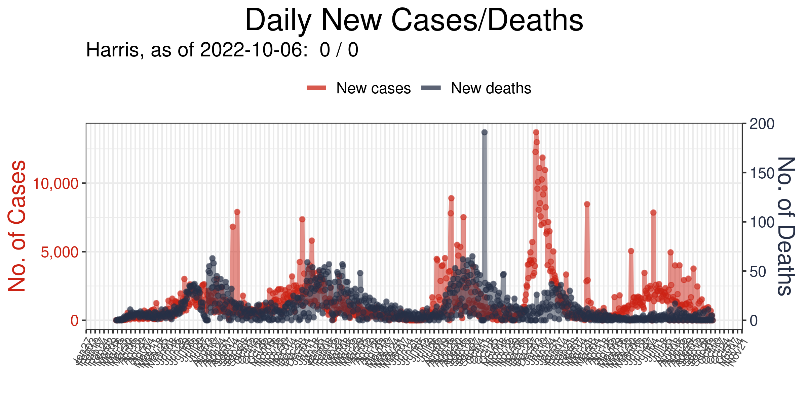  |  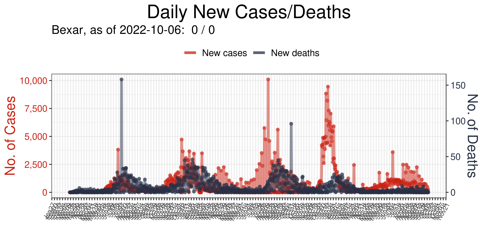  |  

|  3. Dallas  |  4. Tarrant  |  
|  :---   |   :---   |  
|  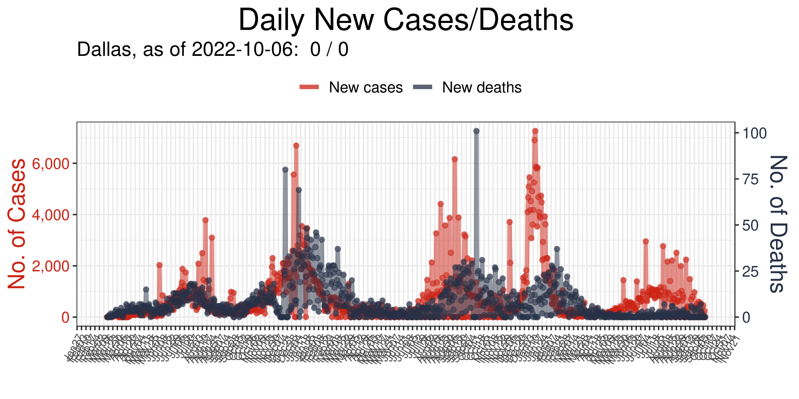  |  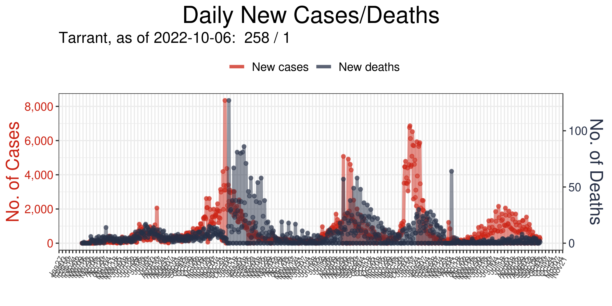  |  

|  5. Travis  |  6. Collin  |  
|  :---   |   :---   |  
|  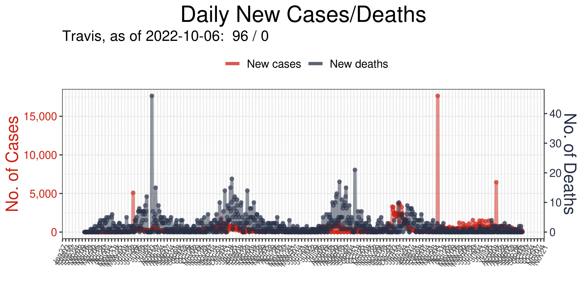  |  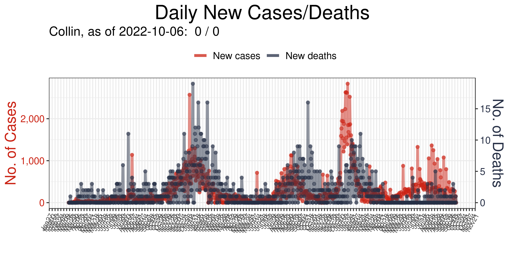  |  

|  7. Hidalgo  |  8. El Paso  |  
|  :---   |   :---   |  
|  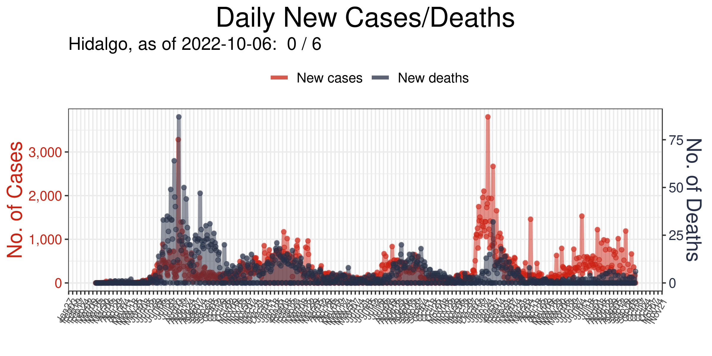  |  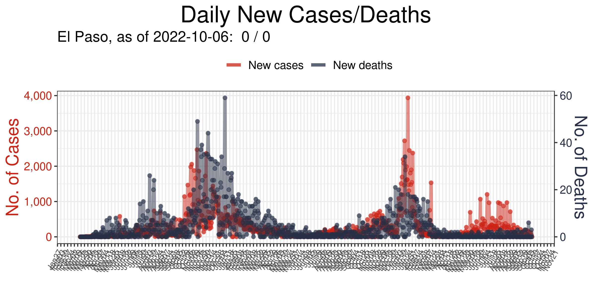  |  

|  9. Fort Bend  |  10. Denton  |  
|  :---   |   :---   |  
|  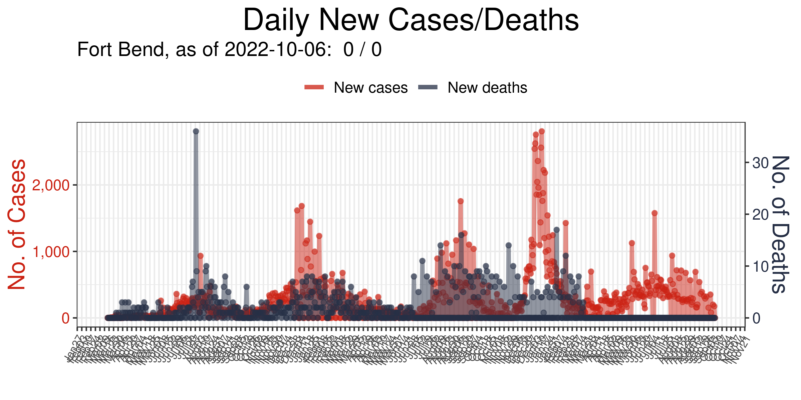  |  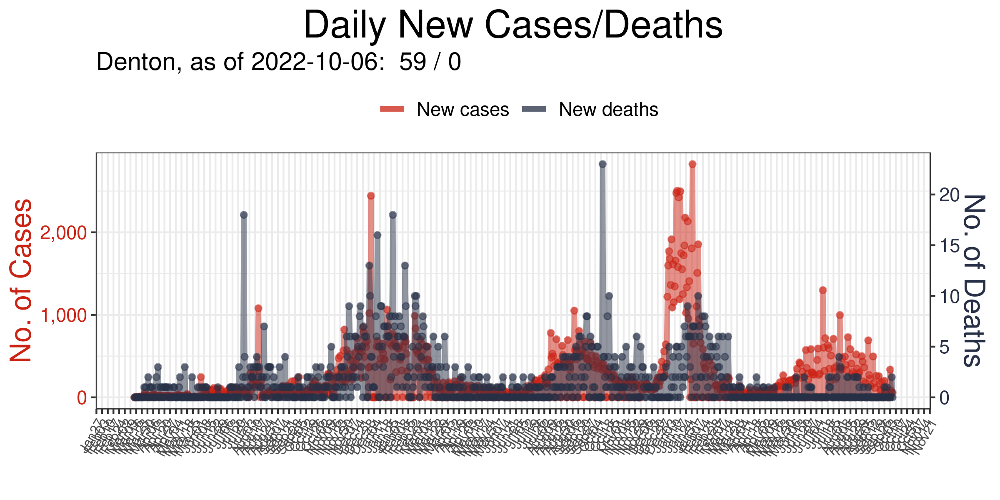  |  

|  11. Montgomery  |  12. Williamson  |  
|  :---   |   :---   |  
|  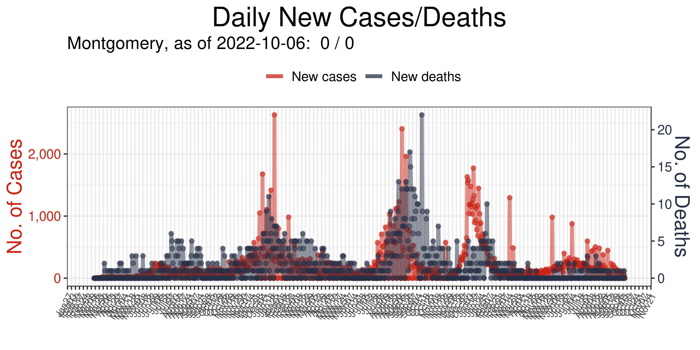  |  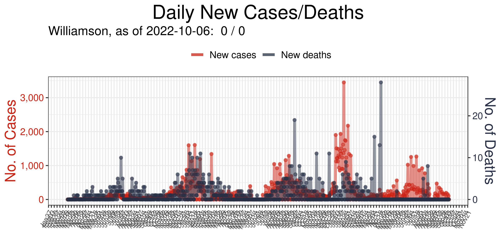  |  

|  13. Cameron  |  14. Nueces  |  
|  :---   |   :---   |  
|  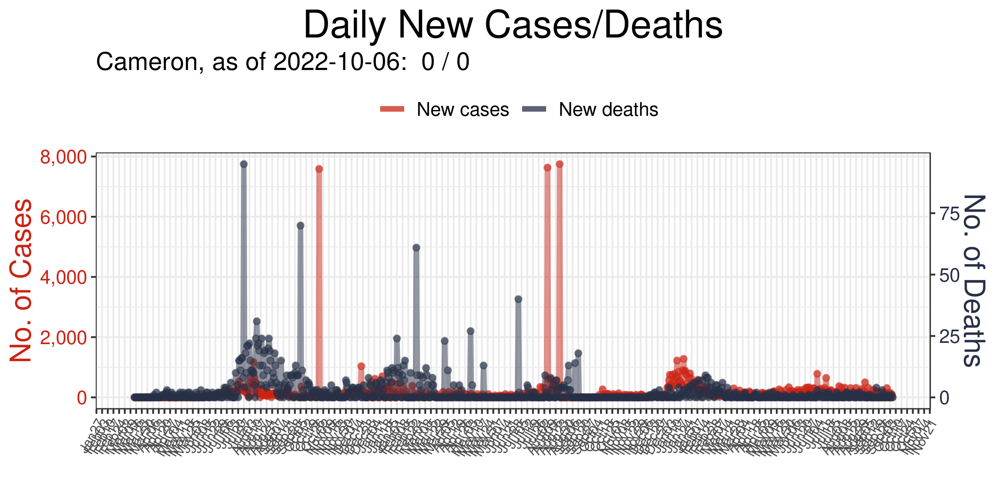  |  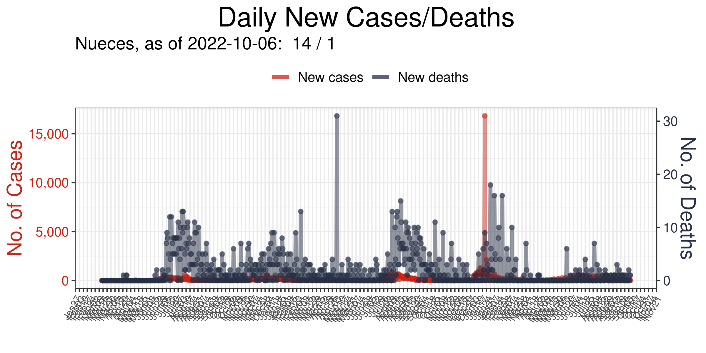  |  

|  15. Galveston  |  16. NA  |  
|  :---   |   :---   |  
|  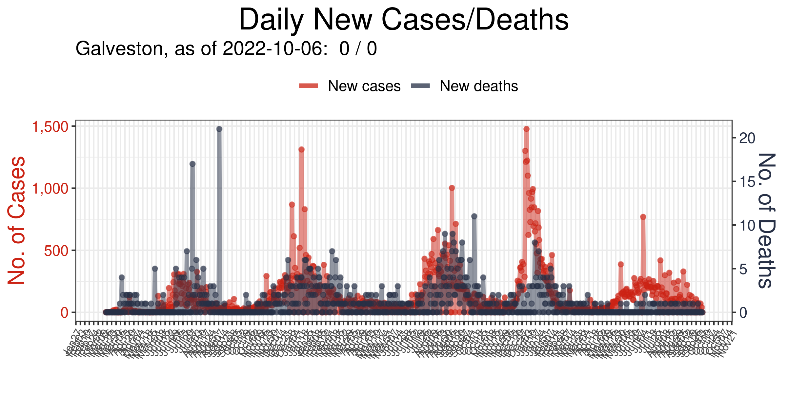 |   NA  |  

