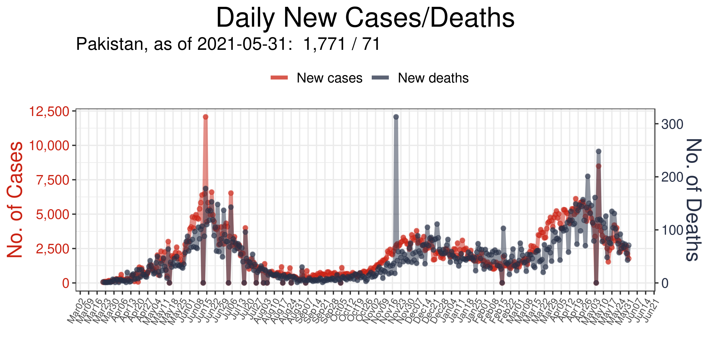

 
&nbsp;
 

 
&nbsp;
 

## 2022-06-30, COVID-19 Time Series
# Countries (top 50)

 
&nbsp;
 

|  1. US  |  2. India  |  
|  :---   |   :---   |  
|    |    |  

|  3. Brazil  |  4. France  |  
|  :---   |   :---   |  
|    |    |  

|  5. Germany  |  6. United Kingdom  |  
|  :---   |   :---   |  
|    |    |  

|  7. Italy  |  8. Korea, South  |  
|  :---   |   :---   |  
|    |    |  

|  9. Russia  |  10. Turkey  |  
|  :---   |   :---   |  
|    |    |  

|  11. Spain  |  12. Vietnam  |  
|  :---   |   :---   |  
|    |    |  

|  13. Argentina  |  14. Japan  |  
|  :---   |   :---   |  
|    |    |  

|  15. Netherlands  |  16. Australia  |  
|  :---   |   :---   |  
|    |    |  

|  17. Iran  |  18. Colombia  |  
|  :---   |   :---   |  
|    |    |  

|  19. Indonesia  |  20. Mexico  |  
|  :---   |   :---   |  
|    |    |  

|  21. Poland  |  22. Portugal  |  
|  :---   |   :---   |  
|    |    |  

|  23. Ukraine  |  24. Malaysia  |  
|  :---   |   :---   |  
|    |    |  

|  25. Thailand  |  26. Austria  |  
|  :---   |   :---   |  
|    |    |  

|  27. Israel  |  28. Belgium  |  
|  :---   |   :---   |  
|    |    |  

|  29. South Africa  |  30. Chile  |  
|  :---   |   :---   |  
|    |    |  

|  31. Canada  |  32. Czechia  |  
|  :---   |   :---   |  
|    |    |  

|  33. Taiwan*  |  34. Switzerland  |  
|  :---   |   :---   |  
|    |    |  

|  35. Philippines  |  36. Greece  |  
|  :---   |   :---   |  
|    |    |  

|  37. Peru  |  38. Denmark  |  
|  :---   |   :---   |  
|    |    |  

|  39. Romania  |  40. Slovakia  |  
|  :---   |   :---   |  
|    |    |  

|  41. Sweden  |  42. Iraq  |  
|  :---   |   :---   |  
|    |    |  

|  43. China  |  44. Serbia  |  
|  :---   |   :---   |  
|    |    |  

|  45. Bangladesh  |  46. Hungary  |  
|  :---   |   :---   |  
|    |    |  

|  47. Jordan  |  48. Georgia  |  
|  :---   |   :---   |  
|    |    |  

|  49. Ireland  |  50. Pakistan  |  
|  :---   |   :---   |  
|    |    |  

Korea, South  
    

